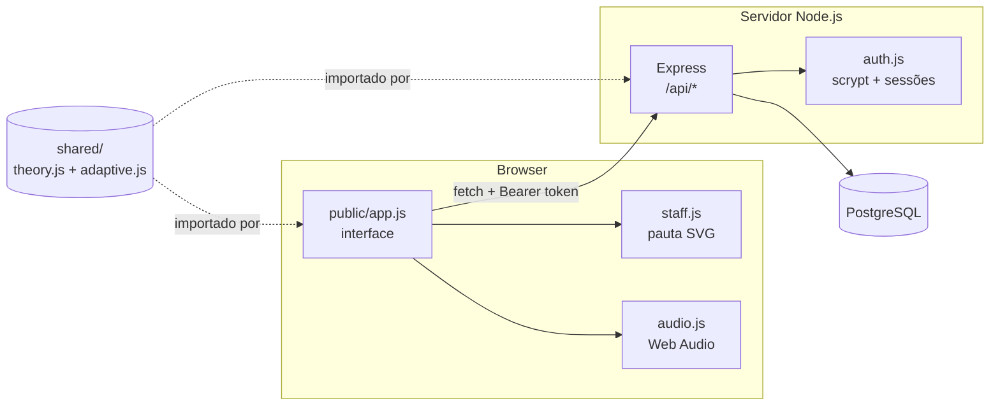

# Treino de Teoria Musical

Aplicação web para treinar teoria musical **de ouvido** e **na pauta**: leitura de notas, intervalos,
acordes e escalas/modos. Os exercícios são gerados automaticamente e a dificuldade adapta-se a quem
está a treinar: o que se erra aparece mais vezes, e novos itens só se desbloqueiam quando os
anteriores estão dominados.

> **Demo:** _(acrescenta aqui o link do Render)_ · O primeiro acesso pode demorar cerca de 1 minuto
> (o plano gratuito adormece o servidor quando não é usado).

## Funcionalidades

- **4 categorias**: notas (Dó4 a Lá5), 12 intervalos, 9 acordes (tríades e sétimas), 10 escalas e modos.
- **2 modos**: de ouvido (som gerado no browser) e na pauta (clave de sol desenhada em SVG).
- **Ortografia musical correta**: as notas são escritas pela distância entre letras, não só por semitons
  (3ª menor de Mi = Sol, não Fá𝄪; meio-diminuto de Si♭ inclui Fá♭).
- **Dificuldade adaptativa** (sistema de Leitner): cada item tem uma "caixa" de 1 a 5; acertar sobe,
  errar volta à 1; itens na caixa 1 aparecem 16× mais do que na caixa 5.
- **Desbloqueio progressivo**: começa com 3 itens por categoria; o seguinte abre quando todos os atuais
  foram tentados e a média das caixas é ≥ 3.
- **Contas e progresso guardado** em PostgreSQL, com histórico de respostas e gráfico de atividade dos
  últimos 14 dias. Sem conta, o progresso fica no browser.
- **Atalhos de teclado**: números para responder, espaço para ouvir, Enter para continuar.

## Tecnologias

| Parte | Tecnologia |
|---|---|
| Frontend | HTML, CSS e JavaScript (módulos ES), sem framework; **Web Audio API** para o som; **SVG** para a pauta |
| Backend | **Node.js** + **Express**, API REST |
| Base de dados | **PostgreSQL** (com alternativa em memória para desenvolvimento e testes) |
| Segurança | Palavras-passe com **scrypt** + salt; tokens de sessão aleatórios, guardados só como hash SHA-256; limite de tentativas no login |
| Testes | `node:test` (unitários + ponta a ponta) |
| Infraestrutura | Docker, Docker Compose, GitHub Actions (CI), Render (deploy) |

## Arquitetura



- **`shared/theory.js`**: modelo de notas (letra + acidente + oitava), intervalos, acordes, escalas e o
  gerador de exercícios. Corre no browser e no servidor.
- **`shared/adaptive.js`**: sistema de Leitner, escolha ponderada do próximo item, desbloqueio e resumos.
- **O servidor recalcula a caixa de cada item** a partir do valor guardado; o cliente só diz se acertou.
- **Gravar estatísticas e o registo da resposta é uma transação** (ou fica tudo, ou nada).

## Correr localmente

Requisitos: Node.js 20+.

```bash
npm install
npm run dev              # http://localhost:3000 (dados em memória)
```

Com PostgreSQL via Docker:

```bash
docker compose up --build   # http://localhost:3000
```

Ou copia `.env.example` para `.env`, ajusta `DATABASE_URL` e corre `npm run dev`.
As tabelas são criadas automaticamente no arranque (ou com `npm run migrate`).

## Testes

```bash
npm test
```

Cobrem a teoria (ortografia dos intervalos, acordes e escalas, todas as combinações geradas dentro da
tessitura e sem dobrados acidentes), o sistema adaptativo (caixas, desbloqueio, frequência de escolha)
e a API de ponta a ponta (registo, login, sessões, respostas, limite de tentativas).

## Publicar no Render

1. Faz push deste repositório para o GitHub, **com os ficheiros na raiz** (sem pasta por cima).
2. Em [render.com](https://render.com): **New → Blueprint** e escolhe o repositório.
3. O Render lê o `render.yaml`, cria o serviço web e a base de dados e liga-os.
4. Cada `git push` volta a publicar automaticamente.

Os planos gratuitos mudam com frequência (o servidor adormece sem uso; a base de dados gratuita pode
ter prazo). Confirma as condições atuais.

## API

| Método | Caminho | Autenticação | Descrição |
|---|---|---|---|
| GET | `/api/health` | – | Estado e tipo de armazenamento |
| POST | `/api/register` | – | `{username, password}` → `{token, user}` |
| POST | `/api/login` | – | `{username, password}` → `{token, user}` |
| POST | `/api/logout` | Bearer | Termina a sessão |
| GET | `/api/me` | Bearer | Utilizador atual |
| GET | `/api/progress` | Bearer | Estatísticas por item, resumo por categoria e atividade de 14 dias |
| POST | `/api/answers` | Bearer | `{category, mode, itemId, correct, ms}` → nova caixa do item |

## Limitações e trabalho futuro

- O progresso como convidado não é transferido para a conta ao fazer login.
- O limite de tentativas é por instância (em memória); com várias instâncias usar Redis.
- Só clave de sol e notas inteiras; próximos passos: clave de fá, ritmo, ditado melódico, inversões de acordes.
- Avaliação com utilizadores reais: comparar a taxa de acerto ao longo do tempo com e sem o sistema adaptativo.

---

© 2026 AnnadSG · Todos os direitos reservados. Ver [LICENSE](LICENSE).
